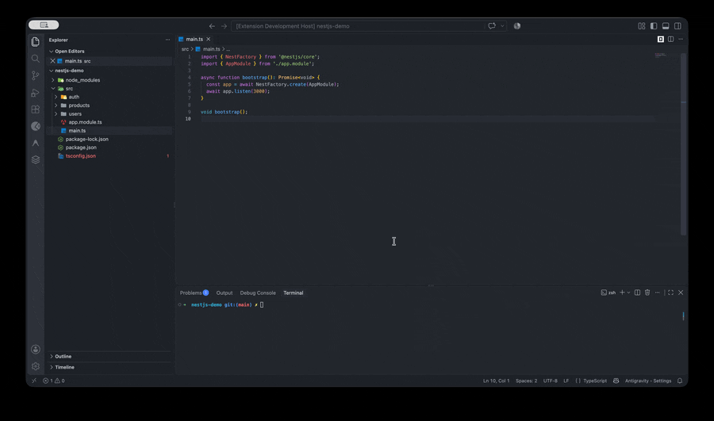

# NestJS API Bridge

[](https://github.com/javiermorenodev/nestjs-api-bridge/actions/workflows/ci.yml)
[](./LICENSE)

Genera clientes Angular y Flutter leyendo tu código NestJS de forma estática, sin levantar el servidor.

## El problema

Si tienes un backend NestJS y un frontend Angular o Flutter, los tipos y las llamadas HTTP viven por duplicado. Cada DTO nuevo, cada ruta que cambia de `/users/:id` a `/users/:userId`, obliga a tocar a mano el servicio del cliente. Es trabajo mecánico, se olvida y rompe en runtime, no en compilación.

La alternativa habitual es Swagger + un generador OpenAPI. Ese camino exige arrancar la aplicación para emitir el spec, anotar cada controller con decoradores de documentación, montar un paso de CI que exporte el JSON y, por último, ejecutar `openapi-generator`. El resultado es código genérico, con namespaces, wrappers y convenciones que no se parecen a las de tu proyecto. Personalizarlo cuesta más que escribirlo.

El dato que cambia todo: la información ya está en tu código fuente. NestJS declara rutas con `@Controller` y `@Get`, y los tipos viven en tus clases y DTOs. Todo eso es un AST de TypeScript. No hace falta ejecutar nada ni mantener un artefacto intermedio que se desincroniza.

## La solución

NestJS API Bridge analiza el proyecto con `ts-morph`, construye un modelo de la API (`ApiSpec`) y genera clientes con plantillas Handlebars desde VS Code:

- Árbol de endpoints en el explorador, agrupados por controlador.
- Servicios Angular (`@Injectable`) con un método por endpoint.
- Cliente de API Flutter y modelos Dart a partir de tus DTOs.
- Comandos de contexto: abrir el handler, copiar la URL, copiar un `cURL` y generar el cliente.

Sin servidor en marcha, sin spec OpenAPI y sin paso de build intermedio.

## Demo



## Instalación

### VS Code

Busca **NestJS API Bridge** en el Marketplace o instálalo desde la línea de comandos:

```bash
code --install-extension javiermorenodev.nestjs-api-bridge-vscode
```

Abre un workspace con `*.controller.ts` y la vista **NestJS Endpoints** aparece en el explorador.

### CLI (próximamente)

```bash
npx @nestjs-api-bridge/cli generate --framework angular --out ./src/app/api
```

## Configuración

Ajustes disponibles en `settings.json` (o en la UI de ajustes de VS Code):

| Opción                            | Tipo   | Por defecto             | Descripción                                                                  |
| --------------------------------- | ------ | ----------------------- | ---------------------------------------------------------------------------- |
| `nestjsApiBridge.baseUrl`         | string | `http://localhost:3000` | URL base para los comandos **Copiar URL** y **Copiar como cURL**.            |
| `nestjsApiBridge.modelsPath`      | string | `../models`             | Ruta relativa desde el servicio generado hasta la carpeta de modelos/DTOs.   |
| `nestjsApiBridge.outputDir`       | string | `""`                    | Carpeta destino de los archivos generados. Vacío pregunta en cada ejecución. |
| `nestjsApiBridge.controllersGlob` | string | `**/*.controller.ts`    | Patrón glob para localizar los controladores.                                |

## Cómo funciona

```text
                        nestjs-demo/src
                              │
              ┌───────────────┴────────────────┐
              ▼                                ▼
      *.controller.ts                      *.dto.ts
              │                                │
              ▼                                ▼
     ┌─────────────────┐              ┌─────────────────┐
     │  Parser         │              │  extractDto     │
     │  (ts-morph)     │              │  (ts-morph)     │
     └────────┬────────┘              └────────┬────────┘
              │ ControllerSpec                 │ DtoSpec
              └───────────────┬────────────────┘
                              ▼
                    ┌───────────────────┐
                    │   Generadores     │  Handlebars
                    │   (core)          │◄────────────
                    └─────────┬─────────┘
              ┌───────────────┼────────────────┐
              ▼               ▼                ▼
      users.service.ts   users_api.dart   create-user.dto.dart
         (Angular)          (Flutter)         (Flutter)
              │
              ▼
   VS Code (árbol de endpoints + comandos) / CLI
```

## Stack técnico

- **ts-morph** — parser estático sobre la API del compilador de TypeScript.
- **Handlebars** — plantillas de los generadores Angular y Flutter.
- **VS Code Extension API** — árbol de endpoints, comandos y watcher de archivos.
- **esbuild** — bundle de la extensión; `tsc` compila el core.
- **Vitest** — tests unitarios y de snapshots.
- **TypeScript** estricto + **npm workspaces** (monorepo `core` / `vscode`).

## Roadmap

### MVP

- [x] Parser de controladores NestJS (`@Controller`, verbos HTTP, params).
- [x] Extracción de DTOs con validadores de `class-validator`.
- [x] Generador de servicio Angular.
- [x] Generador de API Flutter + modelos Dart.
- [x] Extensión VS Code: árbol de endpoints y comandos (abrir, copiar URL/cURL, generar).

### v0.2

- [ ] Publicación en el VS Code Marketplace.
- [ ] CLI `nestjs-api-bridge generate`.
- [ ] Imports automáticos de DTOs en el servicio Angular.
- [ ] Keybindings y comando de refresco de la vista.
- [ ] Soporte de autenticación (Bearer) en los clientes generados.

### v0.3

- [ ] Modo watch: regenerar al guardar.
- [ ] Interceptores y presets de cliente (Dio, React Query).
- [ ] Import/export OpenAPI para interoperabilidad.
- [ ] Internacionalización de las plantillas generadas.

## Contribuir

Las contribuciones son bienvenidas. Lee [CONTRIBUTING.md](./CONTRIBUTING.md) para configurar el entorno, ejecutar los tests y enviar un pull request.

## Licencia

[MIT](./LICENSE) © Javier Moreno
